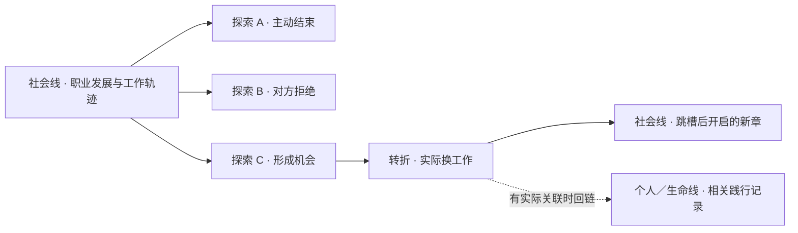

## 设计目标

「人生存档」以三条地位相同的主线作为首页入口。每条线按自己的节奏推进，章节可以在不同时间展开。首页让人一眼看见三条线此刻的状态，地图可以回看它们怎样分开、交会，以及哪些探索最后改变了人生路径。

采用现有 Obsidian「人生存档」插件承载首页和交互地图。Vault 中的 Markdown 笔记保存章节、支线、经历及原始材料。插件根据笔记关系绘制地图。

## 1. 三条主线

| 主线 | 记录范围 | 章节的形成 |
| --- | --- | --- |
| 社会线 | 上学、升学、就业、职业变化和退休等。记录社会角色、制度规则、外界期待及世俗成就，也记录自己在这些条件下走出的路径。 | 升学、进入新行业、实际换工作等，若改变了接下来一段时间的角色或处境，可以形成新章。 |
| 关系与家庭线 | 亲密关系、共同生活、婚育、育儿与照护。 | 关系形态或家庭责任发生实质变化时，可以形成新章。买房、择校等可以作为具体的探索支线，结果也可能关联社会线。 |
| 个人／生命线 | 自我修行本身。通过实际经历，回看自己在意什么、如何行动，以及面对相近处境时有没有做出不同的选择。 | 某个问题反复出现，或数次经历逐渐显出相连的变化时，可以记为暂题。等自己看清这一段经历的脉络，再命名章节。 |

三条线共享时间轴，章节各自在其线内命名与编号。序章、第一章等编号随章节确定后填写。首页允许同时显示已有正式章名、暂题和当前留白。关系、工作等处境如果持续并行，地图就按实际时间并行展示。

## 2. 个人／生命线怎样出现

个人／生命线在首页始终可以进入，章节内容随实际经历逐渐展开。点开可看已确认的章节、浮现中的问题和与之关联的经历。问题出现后可以停留很久，也可以在后来的复盘中改名、合并或放下。暂题只有在本人确认后成为正式章节，日期可以留空或只细化到月。

沿用现有 [[人生主线/自我修行|自我修行]] 笔记作为这条线的入口。用户可以从社会线或关系与家庭线的一件事记录「我当时在意什么、实际怎么做」，再决定是否在个人／生命线上引用这一段。地图在该处绘出交会，同一篇经历从两个入口都能打开。后续出现相似选择，可以继续连到同一个暂题，由本人判断这些经历是否写成一章。

交互沿用游戏里「无法追踪的主线」的体验。个人／生命线展示已有的发现和原文入口。展现方式采用章节、暂题和经历回链，省略目标进度、下一步提示、倒计时和待办数量。AI 复盘如发现反复出现的议题，可在授权的 AI 草稿中提出候选及其依据，由本人决定是否写入生命线。

## 3. 支线探索与新章开始

**章节记录实质发生的变化。支线记录曾经探索过的一种可能。** 一次探索可以关联当前章节，数条探索可以同时展开，也可以相隔几个月。支线结束时保存当时的结果和原因，保留过程原文。后续重新探索同一路径时，可创建新的探索记录并回链。

| 支线状态 | 地图呈现与含义 |
| --- | --- |
| 探索中 | 从关联章节分出，末端保持开放。 |
| 暂停 | 在暂停处标记，可以恢复。 |
| 已结束 | 在终点标记结果，例如主动放弃、对方拒绝或时机过去。点开可看停止时的判断。 |
| 已收束 | 连接到实际发生的转折，保留支线原记录。转折改变了接下来一段生活时，由用户把它确认为新章起点。 |

支线收束允许一条或多条路径共同指向同一转折，也允许所有支线结束后仍停留在原章。决定和转折可分别发生。例如接受邀约可以先记为一次决定，实际入职或工作安排生效后，再按用户确认的日期开启新章。若换工作是直接发生的，也可以从转折直接开章。正式决策档案沿用原有确认流程。[[重大决策模块设计方案]]

### 跳槽示例

已有 [[人生主线/章节/职业发展与工作轨迹|职业发展与工作轨迹]] 可作为社会线的初始章节入口。已有 [[人生主线/跳槽/跳槽|跳槽]] 可作为探索入口，里面继续挂相关路线和过程记录。以下结局用于说明地图规则。

地图展开后，A、B 各有自己的终点，C 连回社会线的新章起点。尝试中的机会只显示在支线区域。假如这次选择也影响了家庭安排，或揭示了一个正在反复出现的个人问题，同一转折可以关联另外一条线。各线是否换章，分别取决于该线发生了什么变化。

## 4. 首页和地图交互

### 首页

页首之后放置三条主线入口。横向空间充足时，三条曲线在同一画布展开，各有同等可见的名称及当前章节入口。每条最多展示一个当前章名或暂题。点选区覆盖标签和对应线段。日历、角色面板、月度摘要与近期记录继续从首页访问，主线入口承担原「当前章节」卡片的导航用途。

| 操作 | 画面变化 |
| --- | --- |
| 打开首页 | 三条线直接显示在当前时间附近。真实共享的事件可见为交会点，色彩和文字共同标识所属主线。 |
| 点选某一条线 | 所选线加深并展开当前章节，其余两线淡化并保留位置。旁边显示该线的章节摘要与相关节点。个人／生命线在这里显示已发现的经历与暂题。 |
| 打开完整地图 | 沿用首页已选主线，进入可回看历史的视图。首页入口也支持直接进入三线总览。 |
| 选中转折或交会 | 高亮连接到该节点的路径，显示日期、关联主线、支线结局和原文入口。 |
| 返回总览 | 三条线恢复同等强调，保留进入详情前的时间位置和键盘焦点。 |

### 完整地图

时间从左向右，三条线以稳定的轨道显示。实际跨线经历用标注或连线表现相互影响。章节用有名称的区段表示，转折用带日期的节点表示。支线默认折叠为关联章节附近的分支入口，点开后可看各条探索的起止、结局与收束去向。未注明时间的笔记在对应线下列出，待日期明确后进入时间轴。只有月份的记录按月展示，章序可用于同月或无日期时的阅读排序。

动效服务于定位。点选时先突出该线，再展开相邻详情，建议以约 240 毫秒的颜色、透明度和位置过渡为起点。地图初始静止，切换时保持时间锚点稳定。交会和收束通过布局及高亮表达，无需播放才能读懂。窄分栏下使用三行入口与可滚动时间轴，另提供按章节和日期排列的文字列表。键盘可完成同样的导航，系统开启减少动态效果时直接切换状态。 [MDN Web Animations API](https://developer.mozilla.org/en-US/docs/Web/API/Web_Animations_API) · [MDN 减少动态效果设置](https://developer.mozilla.org/en-US/docs/Web/CSS/Reference/At-rules/@media/prefers-reduced-motion)

## 5. Vault 内容与数据关系

沿用 `人生主线/` 和现有笔记。三条主线各有一篇入口笔记，管理自己的章节入口和当前显示项。章节、支线、转折各自独立成篇，已有符合用途的笔记可继续使用。日记、决策及其他原始记录通过 Obsidian 链接引用。首版让 Markdown 直接承载以下关系。

| 内容 | 地图读取的属性 | 正文内容 |
| --- | --- | --- |
| 主线入口 | 主线标识、当前章或暂题链接 | 线的简介、相关章节入口 |
| 章节 | 所属主线、暂题或正式状态、可选起止日期、可选顺序、可选起点转折 | 这一阶段经历了什么、相关支线和复盘 |
| 支线 | 起点章节、可选起止日期、状态、可选收束转折 | 探索什么、做过什么、结束原因和来源 |
| 转折 | 涉及主线、实际发生时间及其精度 | 发生了什么、关联经历和已确认决策 |

线与线交会时共用一个转折或经历链接。支线从自身属性指向收束转折，章节从自身属性指向起点转折。插件根据这些链接生成反向关系。支线状态「已收束」要求有可解析的转折；缺失时显示可修复提示，同时保留该支线现有内容。个人／生命线的暂题可以只填名称和关联经历。首页优先使用用户明确选定的当前项，留空时显示该线入口及已有章节。

## 6. 实现路线

| 方案 | 适用性 |
| --- | --- |
| **现有 Obsidian 插件（采用）** | 插件已经通过 `ItemView` 渲染自定义首页、读 Vault 和打开 Markdown 笔记。可以在当前 TypeScript 与 DOM 结构中绘制矢量路径，用 CSS 或 Web Animations API 做过渡。首页和完整地图共用一套关系数据。 |
| Obsidian Canvas 作为交互主界面 | 适合手工摆放、连线和编辑，现有 Canvas 可继续从原入口查看。按章节状态动态生成关系、首页点选过渡和可访问列表更适合在自定义视图中实现。 |
| 独立网页读取导出的 Vault 数据 | 适合将来需要脱离 Obsidian 使用时。网页需要另外处理数据导出、本地访问或同步，以及从网页定位原笔记。 |

首版把真实数据留在本地 Vault，由插件视图用 DOM 渲染文本和按钮、用 SVG 绘制可缩放的线条。复用现有 Vault 读取、链接解析、笔记打开和文件变动监听。启动时读三条主线和首页需要的当前项，打开完整地图时再索引地图笔记。文件变动更新相关节点，重新计算布局时保留当前筛选与时间位置。官方 API 支持自定义视图和 Vault 文件访问，动效流畅度仍需在当前桌面 Obsidian 中以实际数据验收。 [Obsidian 自定义视图示例](https://docs.obsidian.md/Plugins/Getting%20started/Use%20React%20in%20your%20plugin) · [Obsidian Vault API](https://docs.obsidian.md/Plugins/Vault)

## 7. 接入顺序与验收

1. **三线接入。** 加入三个入口和章节读取。接入已有职业章节、自我修行笔记与跳槽笔记，沿用原文件路径及用户正文。关系与家庭线只显示实际配置。若三线资料尚未配置，保留从现有章节和 Canvas 进入的路径。
2. **首页交互。** 检查三线等权、点选展开、详情返回、窄分栏、明暗主题与键盘导航。切换减少动态效果后，确认节点、状态及导航仍完整可读。
3. **分岔与收束。** 用跳槽示例演练并行和错时探索、主动结束、被拒绝、暂停再继续、支线收束后正式开章。验证机会形成时首页仍显示原章，转折确认后才可显示新章。
4. **生命线与原文回链。** 走通无暂题、有暂题、正式成章三种状态。验证一个经历能从不同主线打开同一篇笔记。验证文件改名、链接失效和日期精度不同时的表现。
5. **回归现有入口。** 验证日历、角色面板、复盘与原 Canvas 的链接可用。确认生效后的地图从 Vault 读取，日常维护只需编辑相应笔记。
